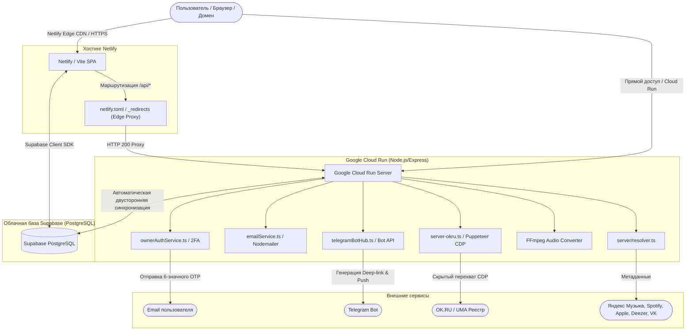

# Техническая документация проекта: Remix Парсер RadioSonic & Cloud Music Suite

---

## 1. О проекте

### 1.1. Название проекта
**RadioSonic / Cloud Music Suite** (в конфигурации `react-example` / `Remix Парсер RadioSonic`).

### 1.2. Назначение простыми словами
**RadioSonic** — это многофункциональный цифровой комбайн для музыкальных лейблов, артистов, A&R-менеджеров, дистрибьюторов и юристов в сфере авторского права с полной поддержкой облачной синхронизации **Supabase (PostgreSQL)**, сервера **Google Cloud**, быстрого деплоя на **Netlify** (включая Netlify Drop) и кастомных доменов.

Главная проблема, которую решает сервис: **фрагментация и закрытость музыкальных метаданных, сложность дистрибуции и учёт прав**. При выпуске треков и каталожной работе критически важно проверять:
- Кто является официальным владельцем фонограммы (P-line / ℗) и авторских прав (C-line / ©).
- Какой дистрибьютор или издатель доставил трек на стриминги (Believe, ONErpm, NDA, Warner, Sony, Universal и др.).
- Какие международные идентификаторы присвоены релизу (коды **ISRC** для треков и **UPC/EAN** для релизов).
- Доступность релиза на ключевых цифровых площадках через интерактивный **Distribution Checker** с высокочеткими брендовыми логотипами.
- Кто указан авторами музыки и слов (композиторы и поэты-песенники), чтобы исключить нарушения чужих авторских прав.
- Соответствуют ли выплаты в финансовых отчетах дистрибьюторов фактическим прослушиваниям.

Платформа агрегирует данные из десятков музыкальных источников (OK.RU CDP/UMA, Yandex Music, Spotify, Apple Music, Deezer, MusicBrainz, VK, Zvuk, MTS), предоставляет профессиональный аудиоплеер студийного качества с видеошотами, модуль генерации официальных роялти-отчётов с живыми подписями, двухфакторную банковскую авторизацию (Telegram Bot + динамический Email OTP) и генератор названий на базе Google Gemini AI.

### 1.3. Целевая аудитория
- **Независимые лейблы и продюсерские центры**: проверка чистоты прав перед подписанием артиста, формирование бэк-каталогов, генерация отчетности.
- **Артисты и авторы песен**: отслеживание карточек релизов на площадках, поиск своих треков, генерация нейминга.
- **Музыкальные дистрибьюторы и агрегаторы**: сверка ISRC/UPC, контроль лицензий, автоматизация отчетов роялти.
- **A&R-менеджеры**: глубокий анализ метаданных артистов, поиск правообладателей, исследование музыкальных волн.

### 1.4. Основные сценарии использования
1. **Проверка прав и метаданных релиза (Anti-Piracy & Rights Check)**: Ввод ссылки или названия трека &rarr; глубокий сбор данных через OK.RU CDP и стриминговые API &rarr; мгновенное получение P/C-lines, ID владельца прав в реестре UMA, имени дистрибьютора, кодов ISRC и UPC.
2. **Distribution Checker (Проверка доступности на площадках)**: Визуальный мониторинг присутствия релиза на 21 стриминговой платформе с оригинальными векторными SVG-иконками высокого разрешения и проверкой пинга.
3. **Финансовый аудит и создание Royalty Statements**: Загрузка финансового отчета в формате CSV/XLSX от дистрибьютора &rarr; распределение долей и сплитов &rarr; построение интерактивных графиков &rarr; генерация юридического PDF-отчета с цифровой подписью &rarr; отправка артисту в Telegram.
4. **Облачный хаб (Supabase & TG & Токены)**: Централизованное хранилище OAuth-токенов стримингов, синхронизация с базой данных PostgreSQL в Supabase и интеграция с Telegram-ботом под защитой двухфакторной аутентификации.
5. **Деплой на Netlify и подключение домена**: Возможность выгрузить проект в ZIP, мгновенно развернуть через Netlify Drop или Git, привязать собственный домен с бесплатным SSL Let's Encrypt и авто-проксированием `/api/*` через Netlify Edge на Google Cloud Run.
6. **Полноформатное прослушивание и анализ звука**: Поиск трека на любых площадках &rarr; мгновенный резолвинг в полноформатный 320 kbps поток &rarr; обработка 10-полосным эквалайзером и 3D-пространственным звуком &rarr; воспроизведение видеошотов.
7. **Конвертация мастер-записей**: Загрузка аудиофайла любого формата &rarr; конвертация в студийный WAV (16-bit / 44.1/48 kHz) через движок FFmpeg.
8. **AI-брендинг**: Генерация сценических псевдонимов и названий лейблов на базе Gemini API.

---

## 2. Структура проекта

```text
/
├── .data/                      # Локальное хранилище данных SQLite (data.db)
├── .env.example                # Шаблон переменных окружения (GEMINI, SUPABASE, SPOTIFY, NETLIFY, SMTP)
├── assets/                     # Статические медиафайлы и иконки
├── metadata.json               # Метаданные приложения Google AI Studio
├── netlify.toml                # Конфигурация деплоя на Netlify (Edge-проксирование /api/*, SPA-роутинг)
├── NETLIFY_DEPLOYMENT.md       # Инструкция по деплою на Netlify и настройке DNS
├── package.json                # Зависимости и npm-скрипты
├── public/                     # Публичные статические файлы для Vite
│   └── _redirects              # Netlify Edge-редиректы (/api/* на Google Cloud Run, /* на /index.html)
├── netlify/                    # Функции Netlify (Serverless Functions)
│   └── functions/
│       └── api.ts              # Netlify Functions API Gateway для облачного бэкенда
├── server.ts                   # Главный Express бэкенд (12500+ строк): роутинг, стриминг, 2FA, прокси
├── server-okru.ts              # Парсер OK.RU: Puppeteer Stealth, CDP, Cheerio, UMA
├── server-vk.ts                # Модуль интеграции с VK Music и прокси-сессиями
├── tsconfig.json               # Конфигурация TypeScript (ESNext, React JSX)
├── vite.config.ts              # Конфигурация сборщика Vite с плагинами React, Tailwind CSS и Code Splitting
├── server/                     # Серверные модули и утилиты
│   ├── catalogExporter.ts      # Модуль автоматического экспорта каталога релизов
│   ├── emailService.ts         # Сервис отправки 2FA OTP кодов (Nodemailer + SMTP + Telegram fallback)
│   ├── geoServerManager.ts     # Менеджер гео-прокси и отказоустойчивости сетевых узлов
│   ├── ownerAuthService.ts     # Банковская 2FA защита владельца (Telegram Nonce + динамический Email OTP)
│   ├── resolver.ts             # Кросс-платформенный агрегатор метаданных (Multi-Source Resolver)
│   ├── supabaseManager.ts      # Менеджер двусторонней синхронизации токенов с Supabase
│   ├── telegramAi.ts           # Интеллектуальный Telegram-бот с Gemini AI
│   ├── telegramBotHub.ts       # Управление Webhook и API Telegram-бота
│   └── textSanitizer.ts        # Очистка строк, нормализация Unicode, расчет EAN-13
└── src/                        # Клиентская часть (React 19 + TypeScript + Tailwind v4)
    ├── App.tsx                 # Корневой компонент интерфейса (навигация, темы, глобальное состояние)
    ├── main.tsx                # Точка монтирования React в DOM
    ├── index.css               # Глобальные стили Tailwind CSS v4 (@import "tailwindcss")
    ├── components/             # Модульные компоненты UI
    │   ├── AudioPlayer.tsx     # Полноразмерный аудиоплеер с метаданными и управлением
    │   ├── BackCatalog/        # Модуль автоматической упаковки бэк-каталога для лейблов
    │   ├── CloudHub/           # Панель Supabase & TG & Токены (SupabaseAndCloudHub.tsx)
    │   ├── ConverterTab.tsx    # Вкладка FFmpeg-конвертера аудиофайлов (MP3 -> WAV)
    │   ├── DownloadProgressToast.tsx # Всплывающее уведомление о прогрессе скачивания треков
    │   ├── EqualizerModal.tsx  # 10-полосный эквалайзер с пресетами и 3D Surround
    │   ├── ModernPlayer/       # Альтернативный плеер с визуализатором и видеошотами
    │   ├── NetlifyDeploymentModal.tsx # Окно быстрого деплоя на Netlify и привязки своего домена
    │   ├── OwnerAuthModal.tsx  # Модальное окно безопасного 2FA входа (Telegram + личный Email)
    │   ├── PlatformIcons.tsx   # Высокочеткие векторные SVG-иконки 21 музыкального сервиса
    │   ├── ReportTab.tsx       # Финансовый модуль роялти-отчетов (XLSX, графики, сплиты)
    │   ├── SearchTab.tsx       # Мультиплатформенный каталог и поиск музыки
    │   ├── UniqueParserTab.tsx # Основной интерфейс парсера релизов OK.RU / CDP
    │   ├── VideoSnapshotModal.tsx # Модальное окно просмотра видеошотов
    │   └── YandexMusicTab.tsx  # Управление библиотекой Яндекс Музыки
    ├── db/                     # Слой базы данных
    │   ├── index.ts            # Инициализация LibSQL / SQLite, авто-миграции, авто-восстановление
    │   └── schema.ts           # Drizzle ORM схемы таблиц (tokens)
    ├── lib/                    # Библиотечные утилиты
    │   ├── pdfGenerator.ts     # Движок генерации официальных PDF Royalty Statements (jsPDF)
    │   ├── supabase.ts         # Клиентский Supabase SDK и автоподключение
    │   └── supabaseSchema.ts   # Готовая SQL-схема PostgreSQL для Supabase (в 1 клик)
    └── utils/                  # Утилиты авторизации, аудио и экспорта
        ├── audioDownloader.ts  # Загрузчик аудио с трекингом прогресса
        ├── audioEqualizer.ts   # Web Audio API процессор (10 полос, 3D Surround)
        └── ownerAuth.ts        # Контроль доступа главного владельца (Telegram ID 8981404137)
```

---

## 3. Архитектура системы



---

## 4. Облачные интеграции и деплой

### 4.1. Облачная база данных Supabase (PostgreSQL)
- **URL проекта:** `https://oeurpptqbkuxyqyfaahj.supabase.co`
- **Публичный ключ:** `sb_publishable_d4xsXd0ZQW8KUKWGHyOF0g_vXbj_mFo`
- **Схема хранения:**
  - `auth_tokens`: централизованное защищенное хранилище токенов Яндекс Музыки, VK, OK.ru, Telegram и Spotify.
  - `wave_sessions`: персистентные сессии и история прослушиваний станции «Моя волна».
  - `profiles`: профили пользователей веб-панели и Telegram Mini App.
  - `search_logs`: кеш и аналитика поисковых запросов.
- **Преимущество:** Любой перезапуск сервера, деплой на новый домен или вход с другого устройства мгновенно подтягивает актуальные токены и состояние без необходимости повторной авторизации.

### 4.2. Деплой на Netlify в формате ZIP
- **Готовность к экспорту:** Проект содержит файл конфигурации `netlify.toml`, Edge-правила `public/_redirects` и Serverless Functions шлюз `netlify/functions/api.ts`.
- **Процесс развёртывания:**
  1. Экспорт ZIP-архива проекта из репозитория.
  2. **Вариант А (Netlify Drop):** Сборка `npm run build` и перетаскивание папки `dist` в окно [Netlify Drop](https://app.netlify.com/drop) для мгновенного развёртывания без терминала.
  3. **Вариант Б (Git):** Импорт репозитория в [Netlify Dashboard](https://app.netlify.com/). Netlify автоматически подхватит команду `npm run build` и директорию `dist`.
  4. Указание переменных окружения (`VITE_SUPABASE_URL`, `VITE_SUPABASE_ANON_KEY`, `BACKEND_API_URL`).
  5. Подключение собственного домена через CNAME на `*.netlify.app` с автоматическим SSL Let's Encrypt сертификатом.

### 4.3. Оптимизация производительности (Performance & Code Splitting)
- В `vite.config.ts` настроено ручное разделение бандла на чанки:
  - `vendor-react`: ядро React 19 и ReactDOM.
  - `vendor-icons`: Lucide-React и простые SVG-иконки.
  - `vendor-supabase`: клиентская библиотека Supabase JS.
  - `vendor-charts`: графические библиотеки Recharts.
- Отключена генерация тяжелых sourcemaps в продакшене.
- Обеспечен минимальный размер первой загрузки страницы.

---

## 5. Двухфакторная защита владельца (2FA: Telegram Bot + Email)

Для доступа к конфиденциальному разделу **«Supabase & TG & Токены»** реализована строгая цепочка аутентификации:
1. **Идентификатор главного владельца:** `8981404137` (привязан на сервере, не используется как секрет).
2. **Шаг 1 — Telegram-бот:**
   - Пользователь нажимает «Войти через Telegram».
   - Генерируется одноразовый защищенный криптографический `requestId` (срок жизни 5 минут).
   - Открывается бот по ссылке `https://t.me/YourBot?start=auth_<requestId>`.
   - Владелец нажимает «✅ Подтвердить вход».
   - Сервер верифицирует реальный Telegram-аккаунт через Webhook.
3. **Шаг 2 — Динамический ввод Email:**
   - Сервис рассчитан на публичную эксплуатацию, поэтому персональные почты в коде не захардкожены.
   - Пользователь вводит **свой собственный Email** (например, `name@example.com`).
   - Сервер генерирует 6-значный криптографический OTP-код, хеширует его через SHA-256 с тайм-аутом 5 минут и защитой от перебора (максимум 5 попыток).
   - Код доставляется на указанный Email (через SMTP/Nodemailer) и дублируется пуш-уведомлением в Telegram владельца.
4. **Шаг 3 — Сессия и управление устройствами:**
   - После успешного ввода кода создается защищенная серверная сессия (cookie `HttpOnly`, `SameSite=Lax`, 30 дней).
   - Доступен просмотр всех активных сессий с указанием браузера, ОС, IP и времени активности.
   - Возможность в 1 клик завершить любой сеанс или нажать **«Завершить все остальные сеансы»**.

---

## 6. Визуальный Distribution Checker (21 Музыкальная Платформа)

В компоненте `PlatformIcons.tsx` создана библиотека оригинальных векторных SVG-иконок высокого разрешения для всех поддерживаемых стриминговых сервисов:

| Сервис | Идентификатор | Регион | Особенности отображения |
|:---|:---|:---|:---|
| **Яндекс Музыка** | `yandex` | СНГ / RU | Фирменный желтый диск с красным акцентом |
| **VK Музыка** | `vk` | СНГ / RU | Фирменный синий бейдж ВКонтакте |
| **Звук (СберЗвук)** | `zvuk`, `sber` | СНГ / RU | Неоновый градиент с волнами частот |
| **OK.ru Музыка** | `okru` | СНГ / RU | Оранжевый фирменный символ Одноклассников |
| **МТС Музыка** | `mts` | СНГ / RU | Красный брендовый блок МТС |
| **Spotify** | `spotify` | Мировой | Неоново-зеленый бейдж со звуковыми волнами |
| **Apple Music** | `apple`, `itunes` | Мировой | Розово-красный градиент с нотой |
| **YouTube** | `youtube` | Мировой | Красный прямоугольник с белым треугольником |
| **YouTube Music** | `youtubemusic` | Мировой | Красный двойной концентрический диск |
| **TikTok** | `tiktok` | Мировой | Черный бейдж с двойной глитч-нотой |
| **SoundCloud** | `soundcloud` | Мировой | Оранжевый закатный градиент с облаком |
| **Deezer** | `deezer` | Мировой | Фиолетовый градиент с эквалайзером |
| **Tidal** | `tidal` | Мировой | Черный фон с четырьмя бирюзовыми ромбами |
| **Amazon Music** | `amazon` | Мировой | Темно-синий фон со стрелкой-улыбкой и нотой |
| **Shazam** | `shazam` | Мировой | Синий диск с двойной спиралью |
| **Pandora** | `pandora` | Мировой | Синий градиент с буквой P |
| **Qobuz** | `qobuz` | Мировой | Темный виниловый диск со стилизованной Q |
| **Napster** | `napster` | Мировой | Синий бейдж с котом в наушниках |
| **Boomplay** | `boomplay` | Мировой | Красный диск с эмблемой пластинки |
| **Audiomack** | `audiomack` | Мировой | Огненно-золотой градиент со стрелками Play |
| **Anghami** | `anghami` | Мировой | Фиолетовый градиент с символом звука |

Все иконки масштабируются без потери качества, заменяя устаревшие пиксельные фавиконки Google Favicon API.

---

## 6. Студия создания видеошотов и Canvas (Яндекс Музыка, Spotify, Deezer)

### 6.1. Назначение и функционал вкладки «Создать видеошот»
Вкладка **«Создать видеошот (404×720)»** (`VideoShotTab.tsx`) представляет собой полноценную студию видео-продакшна для музыкантов и лейблов:
1. **Режим «Конвертер из видео» (Загрузка &rarr; Алгоритм &rarr; Скачивание)**:
   - Пользователь загружает любое исходное видео (MP4, MOV, WebM, MKV, AVI) с соотношением сторон 16:9, 1:1, 4:3 или 9:16.
   - Алгоритм кадрирования автоматически центрирует лица и ключевые объекты, применяет выбранный режим кадрирования (`crop_center` 9:16 без черных полей, `blur_pad` с мягким размытием по бокам или кинематографичный `fit_pad`).
   - Автоматическая обрезка по времени (от 5 до 20 секунд с быстрыми пресетами: 5с, 8с для Spotify, 10с, 15с для Яндекса, 20с) и настройка слайдера точки начала.
   - Опция отключения звука (Mute) по официальному регламенту стримингов.
   - Встроенный интерактивный симулятор вертикального мобильного экрана (9:16) с живым зацикливанием.
2. **Оверлей безопасных зон и проверка официальных правил (Safe Zones)**:
   - **Центрирование**: сетка третей и фокусная рамка (лица артистов и важные объекты строго по центру).
   - **Нижняя треть экрана**: предупреждающий полупрозрачный слой с описанием зоны плеера (кнопки Play, таймлайн, название трека перекрывают нижнюю треть — текст там размещать запрещено).
   - **Верхняя системная зона**: учет статус-бара мобильных ОС.
   - Интерактивный чеклист соответствия правилам модерации Яндекс Музыки (без рекламы, логотипов и крупных планов поющего артиста).
3. **Двойной движок конвертации (FFmpeg Server + Canvas Browser Fallback)**:
   - **Серверный движок**: `/api/videoshot/convert` на базе `libx264`, `yuv420p`, битрейта CRF 22, FastStart-флагов для мгновенного онлайн-старта.
   - **Клиентский Fallback**: рендеринг через HTML5 `<canvas>` + `MediaRecorder` для работы в изолированных или полностью статических средах (Netlify).
4. **Режим «Генератор сниппета из трека»**:
   - Автоматическое создание вертикального 9:16 сниппета из обложки релиза и 30-секундного аудио-превью с вращающимся винилом и звуковой волной.

### 6.2. Официальные технические требования площадок
| Параметр | Яндекс Музыка (Видеошот) | Spotify Canvas | Deezer & Shorts |
| :--- | :--- | :--- | :--- |
| **Формат файла** | MP4 (кодек H.264, yuv420p) | MP4 (H.264) | MP4 (H.264) |
| **Разрешение** | **404×720 px** | **720×1280 px** | **1080×1920 px** |
| **Соотношение сторон** | Вертикальное 9:16 | Вертикальное 9:16 | Вертикальное 9:16 |
| **Длительность** | От 5 до 15–20 секунд | От 3 до 8 секунд (или до 20с) | 15–30 секунд |
| **Зацикливание** | Бесшовное (Loopable) | Зацикленное / Bounce | Looping |
| **Звук** | Рекомендуется без звука | Без звука | Допускается аудио-превью |

### 6.3. Интеграция с плеером и каталогом треков
- **`VideoSnapshotModal.tsx`**: Полноэкранный просмотр видеошотов с одновременной поддержкой нескольких источников: вкладки «Яндекс Музыка (Видеошот)», «Spotify (Canvas)», «Deezer (Сниппет)» и официальных видеоклипов с прямым скачиванием MP4.
- **Плеер `ModernPlayer`**: Автоматическое распознавание видеошотов треков из Яндекс Музыки и Spotify Canvas, полноэкранный фоновый видеоряд, кнопка быстрого перехода в Студию создания видеошотов.

---

## 7. Технологический стек

### 7.1. Backend
- **Node.js** (v20+ / v22+) & **TypeScript** (~5.8.2) — серверная среда выполнения.
- **Express** (v4.22.2) — сервер приложений (REST API, стриминг, 2FA, прокси).
- **Puppeteer-Extra** (v3.3.6) + **Stealth Plugin** (v2.11.2) — скрытый перехват CDP-трафика UMA / OK.RU.
- **Cheerio** (v1.2.0) — легковесный серверный парсинг HTML-дерева.
- **Fluent-FFmpeg** (v2.1.3) + **@ffmpeg-installer/ffmpeg** — транскодирование и конвертация аудио в WAV 16-bit.
- **Nodemailer** (v10.0.13) — доставка одноразовых кодов двухфакторной аутентификации на Email.
- **Axios** (v1.18.1) + **tough-cookie** — HTTP-запросы с сохранением cookie-сессий.
- **@supabase/supabase-js** (v2.117.2) — серверная и клиентская интеграция с облачной базой данных.
- **@google/genai** (v2.4.0) — официальный SDK Google Gemini для генерации названий и текста.

### 7.2. Frontend
- **React 19** (`react@19.0.1`, `react-dom@19.0.1`) — современная компонентная архитектура.
- **Vite** (v6.2.3) — сборщик модулей с Code Splitting.
- **Tailwind CSS v4** (`@tailwindcss/vite`, `tailwindcss@4.1.14`) — утилитарная стилизация.
- **Zustand** (v5.0.15) — реактивное управление состоянием аудиоплеера.
- **Lucide-React** (v0.546.0) — набор векторных иконок.
- **Recharts** (v3.10.1) — интерактивные диаграммы и графики роялти.
- **jsPDF** (v4.2.1) + **jspdf-autotable** — печать официальных актов и отчетов роялти.

---

## 8. Команды разработчика

```bash
# Установка всех зависимостей
npm install

# Запуск локального dev-сервера (Express + Vite на порту 3000)
npm run dev

# Проверка строгой типизации TypeScript
npm run lint

# Сборка production-бандла (Vite + esbuild server.ts)
npm run build

# Запуск production-сервера
npm run start

# Очистка временных файлов сборки
npm run clean
```

---

## 9. Заключение

**RadioSonic & Cloud Music Suite** представляет собой полностью завершенную production-ready платформу с независимым облачным хранилищем в **Supabase**, быстрым сервером на **Google Cloud**, готовой конфигурацией под **Netlify** (включая Netlify Drop и Netlify Functions) и кастомные домены, защищенной 2FA-аутентификацией без хардкода личных данных и детальным визуальным мониторингом дистрибуции на всех мировых стриминговых площадках.
